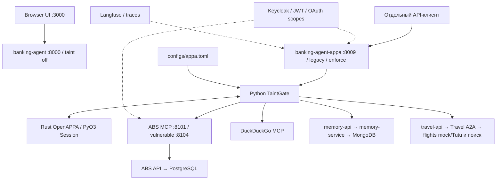

# APPAlab — Agentic Banking Lab + OpenAPPA

Лабораторный банковский агентный стенд с уже интегрированным OpenAPPA и Python/Rust-обвязкой Taint Tracking. Здесь находятся исходники обоих проектов, Docker Compose, политика и тесты. Интеграция сохранена без рефакторинга.

> **Статус:** это зафиксированный прототип, не production-ready банковская система. Полный запуск с чистого окружения и `/v1/chat` пока **UNVERIFIED**. Известные проблемы перечислены ниже, а не скрыты инструкцией запуска.
>
> **Запускайте только на отдельном чистом хосте/VM с отдельным Docker daemon.** Compose использует фиксированные имена, сеть, порты и теги образов. Вторая копия на daemon действующего стенда может его затронуть; одного `-p other` недостаточно. Не используйте реальные счета, клиентские данные и production-ключи.

## 1. Что потребуется

- Linux/WSL2, Docker Engine/Desktop, Docker Compose v2+, Git, Bash и tar.
- Для существующего процесса сборки wheel — Linux x86_64/glibc; другие платформы требуют отдельной проверки.
- Интернет для загрузки Docker-образов, Debian apt, PyPI и crates.io. Rust и maturin устанавливаются/используются внутри сборочного контейнера; Rust на хосте не обязателен.
- Отдельно настроенные **контролируемые локальные** OpenAI-compatible Chat Completions и `/embeddings` endpoints. Готовые LLM/embedding-серверы в Compose **не включены**.
- Python 3.12+ для статических/offline-проверок; команды venv ниже используют `python3.12`.

Без LLM/embeddings контейнеры могут запуститься, но это не означает работоспособность чата. Непустой canary-ключ требуется коду даже для локального провайдера без аутентификации.

## 2. Получить проект и настроить окружение

До merge [PR #1](https://github.com/userIlyas/APPAlab/pull/1) полный проект находится в публикационной ветке, а `main` содержит только минимальную базу:

```bash
git clone --branch publication/initial-agentic-banking-openappa \
  https://github.com/userIlyas/APPAlab.git
cd APPAlab
python3 scripts/verify_snapshot.py

# Только в новом checkout: не перезаписывать существующую .env.
test ! -e agentic-banking-lab/.env && cp .env.example agentic-banking-lab/.env
```

Заполните **новый собственный** `agentic-banking-lab/.env`; не копируйте секретный файл прежнего стенда. Корневой шаблон содержит имена переменных с пустыми значениями. Пустые поля используют публичные учебные defaults, если они заданы в Compose; это не production-настройки.

Основные параметры:

| Переменные | Что указать |
|---|---|
| `OPENROUTER_BASE_URL`, `OPENROUTER_MODEL`, `OPENROUTER_API_KEY` | Доступный **из контейнеров** локальный Chat Completions endpoint, ID его модели и непустой canary-ключ |
| `EMBEDDING_BASE_URL`, `EMBEDDING_MODEL`, `EMBEDDING_API_KEY` | Доступный из контейнеров локальный `/embeddings` endpoint, ID embedding-модели и непустой canary-ключ; это отдельная зависимость |
| `FLIGHTS_PROVIDER=mock` | Использовать включённый flight mock вместо внешнего Tutu; это **не отключает** DDG-поиск |
| `APPA_TAINT_MODE=enforce` | Включить enforcement у отдельного APPA-агента; основной Compose эту переменную агенту не передаёт |
| `ABS_MCP_MODE=secure`, `AUTH_DISABLED=false` | Сохранить защищённый MCP и проверку JWT |
| `MEMORY_ORCHESTRATION_INTERVAL_SECONDS=0` | При необходимости отключить периодическую обработку памяти в новом лабораторном окружении; default — 1800 секунд |

`localhost` внутри контейнера — сам контейнер, не WSL/хост. Проверьте адреса локальных провайдеров для своей Docker-сети; наличие `host.docker.internal` зависит от окружения. Не считайте строки модельных ID из исходных defaults подтверждением доступности моделей.

Все 65 имён и настройки identity/хранилищ/observability: [CONFIGURATION](docs/CONFIGURATION.md). До активных сценариев убедитесь, что внешние провайдеры и реальные банковские системы не подключены.

## 3. Собрать OpenAPPA из исходников

OpenAPPA отдельно как сервер запускать **не нужно**: используется native Python-модуль внутри APPA-агента.

```bash
cd agentic-banking-lab
bash scripts/build_appa_wheel.sh ../OpenAPPA
```

**Внимание:** сохранённый build-скрипт очищает `/tmp/appa-build` и `/tmp/appa-dist`. Выполняйте только на чистом хосте, без параллельной сборки и чужих данных в этих каталогах.

Процесс: исходники `OpenAPPA/` → сборочный контейнер `rust:1.96-bookworm` → maturin → `vendor/appa_agent_python-*.whl`. Каталог исходников должен называться `OpenAPPA`. Wheel не хранится в Git; все нужные исходники включены. Загрузки apt/PyPI/Cargo нужны для сборки, банковские/API credentials — нет.

[Подробности сборки, наблюдённые версии и пределы воспроизводимости](docs/DEPLOYMENT.md).

## 4. Собрать и запустить основной стек, затем APPA-агент

Все команды этого раздела выполняются из `agentic-banking-lab/` **на новом отдельном Docker daemon**, не на действующем стенде:

```bash
# Основная инфраструктура и банковская система.
docker compose --env-file .env -f docker-compose.yml config --quiet
docker compose --env-file .env -f docker-compose.yml build
docker compose --env-file .env -f docker-compose.yml up -d
docker compose --env-file .env -f docker-compose.yml ps -a

# После запуска зависимостей и появления сети agentic-banking_banking:
docker compose --env-file .env -f docker-compose.appa.yml build
docker compose --env-file .env -f docker-compose.appa.yml up -d
docker compose --env-file .env -f docker-compose.appa.yml ps -a
```

Первый Compose создаёт 24 сервиса, сети и новые DB volumes, импортирует demo-realm Keycloak и запускает одноразовый `keycloak-configurator`. Завершение configurator с кодом 0 — ожидаемый результат, не постоянный сервис.

Второй Compose — **самостоятельный проект, не overlay**. Он создаёт `agentic-banking-appa-1`, устанавливает wheel через build ARG `APPA_TAINT_INSTALL=1` и подключается к existing external-сети `agentic-banking_banking`. Не объединяйте два Compose-файла одной командой `-f base -f appa`.

APPA-агент использует общие с основным стеком Keycloak, АБС, память и travel-сервисы. Это отдельный процесс, **не изолированный банк/tenant**. Если external-сеть не найдена, сначала проверьте запуск основного проекта, не подменяйте её сетью действующего стенда.

## 5. Адреса и первичная проверка

| Адрес | Назначение |
|---|---|
| `http://localhost:3000` | UI; JavaScript напрямую обращается к основному агенту на `localhost:8000` |
| `http://localhost:8000` | Основной banking-agent, default orchestrator; **без OpenAPPA enforcement** |
| `http://localhost:8009` | Отдельный APPA-агент, legacy-граф, default enforce |
| `http://localhost:8080` | Keycloak, realm `agentic-banking` |
| `http://localhost:3001` | Банковский Langfuse UI |
| `http://localhost:8001` | ABS API; не использовать для проверки реальных операций |
| `http://localhost:8002` / `:8003` | Boundary API памяти / travel |

Для наблюдения состояния **своего нового разрешённого экземпляра**, без запуска чата или перевода:

```bash
curl --fail --silent --show-error http://127.0.0.1:8009/health
```

Ожидаемые поля `appa_taint`: `mode=enforce`, `engine_available=true`, `policy_loaded=true`, `policy_tools=14`, `fail_closed=true`. Это показывает готовность gate, **не доказывает** полный chat/embedding/MCP E2E.

**UI не переключается на APPA автоматически.** Чат через UI на 3000 — не демонстрация enforcement. APPA API на 8009 принимает `/v1/chat` с обычной банковской OAuth-аутентификацией; токены не публикуйте. Новый полноценный chat-сценарий требует отдельно согласованного mock-only теста. Диагностический `/v1/appa/e2e/transfer` не вызывайте: он способен записывать операции в общий ledger без LLM.

## 6. Как взаимодействуют компоненты



1. Агент получает сообщение и `conversation_id`; ContextVar связывает tool-вызовы с текущим диалогом.
2. Вызовы проходят через существующие MCP/memory/Travel A2A wrappers. `Session.check(tool, arguments, call_id)` принимает решение **до executor**.
3. При допуске executor обращается к сервису; `Session.report` принимает его результат в траекторию. При ошибке executor используется `abandon`. Ошибка report после executor не откатывает уже выполненный эффект.
4. Политика требует `trusted` для `abs.create_transfer`, `abs.pay_service`, `abs.buy_investment_product`. Объявленные недоверенные чтения понижают Trust; последующий денежный sink может быть отклонён до MCP-запроса.
5. Недоверенная память определяется по metadata; travel консервативно считается untrusted. Для настоящего поиска есть **неисправленное расхождение имён**: MCP формирует `search.news_search/text_search`, policy объявляет `search.news/text`. Успешный реальный search-ingress не подтверждён.
6. Метка хранится в native Session с временным SQLite. Перезапуск процесса и вытеснение сессии из cache забывают состояние. Audience/customer binding этой политикой не реализован.

В режиме enforce отсутствие native-модуля, политики или conversation не допускает gated executor. `TaintDenied` превращается в HTTP 409 с `code=policy_denied`. OAuth/RBAC остаются отдельной защитой; OpenAPPA не заменяет авторизацию. Подробная схема и границы: [ARCHITECTURE](docs/ARCHITECTURE.md).

## 7. Offline-проверка без банковских операций

После source-сборки wheel, из **корня APPAlab**, в новой локальной venv:

```bash
python3.12 -m venv .venv
.venv/bin/python -m pip install 'pytest>=8.4,<9' 'pytest-asyncio>=1.2,<2' \
  agentic-banking-lab/vendor/appa_agent_python-*.whl
PYTHON="$PWD/.venv/bin/python" bash scripts/test-native.sh
```

Скрипт проверяет доступность native engine/policy и запускает gate + glue трижды с fake-исполнителями. Ему не нужны HTTP MCP, Keycloak, LLM и банковские сервисы. Во время первоначальной подготовки получены **14/14 gate и 4/4 glue, n=3** на ранее собранном движке; это не новая проверка после чистой сборки. [Полный отчёт о проверках](docs/VALIDATION.md).

## Ограничения и troubleshooting

- **Чистая сборка не подтверждена:** offline Cargo preflight не нашёл `reqwest` в пустом cache/index. Нужны разрешённые загрузки и новая проверка; зависимости/образы частично не закреплены.
- **503 памяти / неработающий чат:** проверьте локальный embedding endpoint и все `EMBEDDING_*`; одного Chat Completions endpoint недостаточно.
- **Поиск отклонён политикой:** известное расхождение wire names и policy не исправлено. Не отключайте enforcement ради обхода.
- **Нет соединения с 8009:** проверьте APPA Compose `ps -a`, сборку wheel, доступность base-сети и зависимостей. При инвентаризации 2026-11-24 APPA-контейнер был остановлен (255); причина не установлена, текущий успешный старт не заявляется.
- **Не весь egress защищён:** финальный текст LLM и лабораторные/прямые API не охвачены универсальным DLP. Диагностический transfer endpoint включён APPA Compose, backend общий.
- **Неперсистентный taint:** restart, replicas и cache eviction не обеспечивают продолжение общей траектории; конкурентные сценарии полностью не проверены.

Полный перечень без сокращений: [LIMITATIONS](docs/LIMITATIONS.md). Ничего из этого не исправлялось при фиксации первой версии.

## Тестовый corpus и GitHub secret alert

`OpenAPPA/bench/sanitizer/corpus/coding.strip-secrets.toml` — **статический upstream benchmark input**, а не файл, генерируемый при запуске банка. Benchmark читает TOML с фиксированными `body`/`drop`/`keep` кейсами; банковский Dockerfile этот corpus в runtime-образ не копирует. Сборочные wheel, кэши и результаты benchmark — другие, генерируемые артефакты; wheel не включён в Git.

GitHub обнаружил в одном из corpus-кейсов значение формата Stripe webhook signing secret. Его действительность/принадлежность **не подтверждены**; наличие в тесте не доказывает невалидность. Предыдущий локальный scanner не охватывал этот формат. Alert не закрыт как false positive или revoked; значение здесь не повторяется. Удаление файла новым коммитом не удалит его из уже опубликованной истории. Удаление исходного corpus или его sanitization — отдельное решение, не автоматическая очистка runtime-файлов.

## Структура и документы

```text
agentic-banking-lab/  Python/FastAPI/LangGraph, MCP, A2A, UI, Compose, политика, тесты
OpenAPPA/            исходный upstream 0.46.1 (Rust + PyO3 и benchmark sources)
integration/         offline glue-проверка; исторические docs/HTTP E2E как *.txt
scripts/             проверки целостности, публикации и native gate
provenance/          исходные SHA, локальные изменения, runtime-инвентарь, manifest
docs/                подробные инструкции и границы проверенного
```

- [Развёртывание](docs/DEPLOYMENT.md) · [Конфигурация](docs/CONFIGURATION.md) · [Архитектура](docs/ARCHITECTURE.md)
- [Безопасность](docs/SECURITY.md) · [Проверки](docs/VALIDATION.md) · [Ограничения](docs/LIMITATIONS.md)
- [Происхождение и версии](docs/PROVENANCE.md) · [Перечень файлов](provenance/PUBLICATION-FILES.txt)

## Upstream и лицензии

- [LLAMATOR-Core/agentic-banking-lab](https://github.com/LLAMATOR-Core/agentic-banking-lab), `b9374e7faab6da0a5045f0f48ae63afd575dc76a` + сохранённые локальные изменения; [MIT](agentic-banking-lab/LICENSE), © 2026 Timur Nizamov.
- [archestra-ai/OpenAPPA](https://github.com/archestra-ai/OpenAPPA), `ada9b33e227537c092f973c89ab42151a3d9f2c3`, 0.46.1; [MIT](OpenAPPA/LICENSE.md), © 2026 Archestra Inc.

Обычный monorepo со снимками, без submodules и вложенных `.git`; upstream-история не импортирована. MIT/OFL notices сохранены: [THIRD_PARTY_NOTICES](THIRD_PARTY_NOTICES.md). Исправление интеграции и рефакторинг — отдельные задачи.
