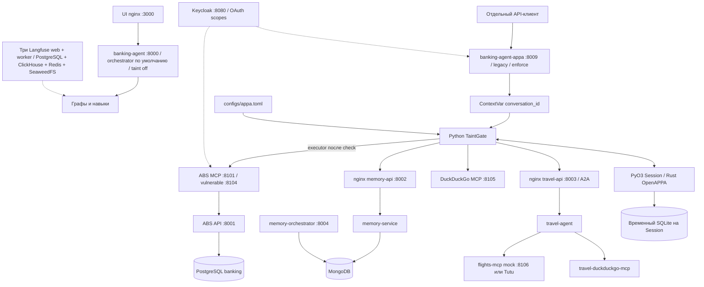

# Архитектура фактической интеграции

Основание: исходники снимка, Docker inspect и чтение файлов существующих контейнеров через docker cp, без exec/HTTP-запросов к агентам. Полный инвентарь: `provenance/runtime-inventory.json`. Состояние контейнера не является доказательством успешного банковского/LLM-сценария.

## Два профиля банковского агента

`services/banking_agent/app.py` создаёт legacy `BankingGraph` и `OrchestratorGraph`; режим выбирает `BANKING_AGENT_MODE`. В orchestrator работают operations/investments/travel с отдельными OAuth-клиентами и scopes. Навыки вызывают фиксированные инструменты; LLM участвует в маршрутизации, извлечении параметров и подготовке ответов.

`docker-compose.yml` содержит основной стек из 24 сервисов; OpenAPPA туда не включён переменными среды или build arg. `docker-compose.appa.yml` — самостоятельное описание ещё одного агента, не overlay основного. Он использует `APPA_TAINT_INSTALL=1`, свой образ и фиксированное имя `agentic-banking-appa-1`, подключается к **существующей** external-сети `agentic-banking_banking`. Он не создаёт собственную АБС: использует общие сервисы/данные. Это изоляция процесса, **не данных/tenant**.

Nginx UI раздаёт статические файлы; `ui/app.js` напрямую обращается из браузера к `http://localhost:8000` и Keycloak на `http://localhost:8080`. Проксирования `/api/` в сохранённом nginx config нет; автоматического переключения UI на APPA тоже нет.

## Границы и точные данные

| Граница | Файл и данные |
|---|---|
| chat → gate | `app.py`: `request.conversation_id` в ContextVar вокруг `graph.ainvoke`, reset в finally |
| агент → MCP | `common/mcp.py`: `canonical = f'{namespace}.{name}'`; tool name и dict arguments передаются `Session.check`, executor делает JSON-RPC `tools/call` с Bearer и trace headers |
| MCP → агент | `structuredContent` либо распарсенный text JSON; результат сериализуется в JSON для `Session.report` перед возвратом из gate |
| память → контекст | `banking_agent/clients.py`, `common/skill_memory.py`: `recall_memory`, сначала trusted `memory.recall`; при metadata.trust с префиксом `untrusted` или source из `{internet,travel-partner,duckduckgo-mcp,user-chat-lab}` — дополнительный synthetic `memory.untrusted` |
| банк → партнёр | `common/travel.py`: gate `travel.plan` вокруг A2A `_send`; понижение Trust консервативное, audience/получатель не ограничены этой политикой |
| gate → native | in-process PyO3, без сети: `Session.check(tool,args,call_id)`, remedy control для разрешённых narrowing, `report`, `abandon` при исключении executor |
| policy → gate | TOML v2, 14 инструментов, trust chain suspicious/trusted; синхронные native-вызовы через `asyncio.to_thread` |

Денежные floors: `abs.create_transfer`, `abs.pay_service`, `abs.buy_investment_product` требуют trusted. Narrowers: `search.text`, `search.news`, `memory.untrusted`, `travel.plan`. Trusted recall и шесть ABS-чтений не понижают Trust. Gate auto-accept narrowing ограничен пересечением env allowlist и объявленных в политике narrowing tools. Поднятие привилегий не auto-accept.

**Расхождение search (статически подтверждено):** MCP публикует `news_search`/`text_search`, а gate просто добавляет namespace; получаются `search.news_search`/`search.text_search`, отсутствующие в политике. Тесты используют `search.news`/`search.text` напрямую. Работу поиска через настоящий MCP эта проверка не доказывает; ожидаемый отказ undeclared tool не проверялся на живом стенде. См. LIMITATIONS.

## Состояние и ошибки

Per-conversation Python-словарь хранит native Session. В каждой Session Rust создаёт отдельный `tempfile::tempdir()`/`appa.db`, внутренний trajectory id — `episode`. Поэтому одинаковый внутренний id не означает общий store между Python-сессиями; состояние всё равно не переживает перезапуск. При достижении 4096 сессий wrapper удаляет старую запись: возвращение к вытесненному conversation_id создаёт новую траекторию.

В enforce отсутствие conversation/движка/политики/session не допускает executor. `TaintDenied` в HTTP-агенте → 409, `code=policy_denied`. Report выполняется **после** executor, поэтому сбой report не откатывает уже исполненный эффект. Observe не считается защитой, off не загружает движок.

## Сборка и сети/хранилища

`OpenAPPA/appa-agent-python` → maturin/Rust → wheel → `agentic-banking-lab/vendor` → условный `pip install` в Dockerfile. Runtime-образ Python 3.12-slim включает common, SERVICE_PACKAGE, configs, vendor; работает как uid 10001. Отдельного OpenAPPA daemon нет.

Сети: banking, memory, travel; internal bank-storage, memory-storage, platform-storage. Boundary nginx имеют по две сети; Keycloak доступен системам; DB не является контейнером APPA. Named volumes: postgres-data, mongo-data, clickhouse-data, clickhouse-logs, redis-data, seaweedfs-data; у Mongo также обнаружен anonymous configdb volume. Данные этих volumes не переносятся в Git.

Bind mounts: UI и nginx config, boundary configs, Keycloak realm, PostgreSQL init SQL, flights-mcp notes. Все соответствующие исходные файлы включены; host runtime paths не нужны для нового развёртывания. APPA-контейнер не имеет mounts, его политика/исходники запечены в образ.
